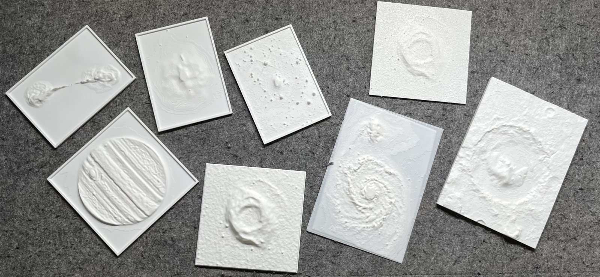
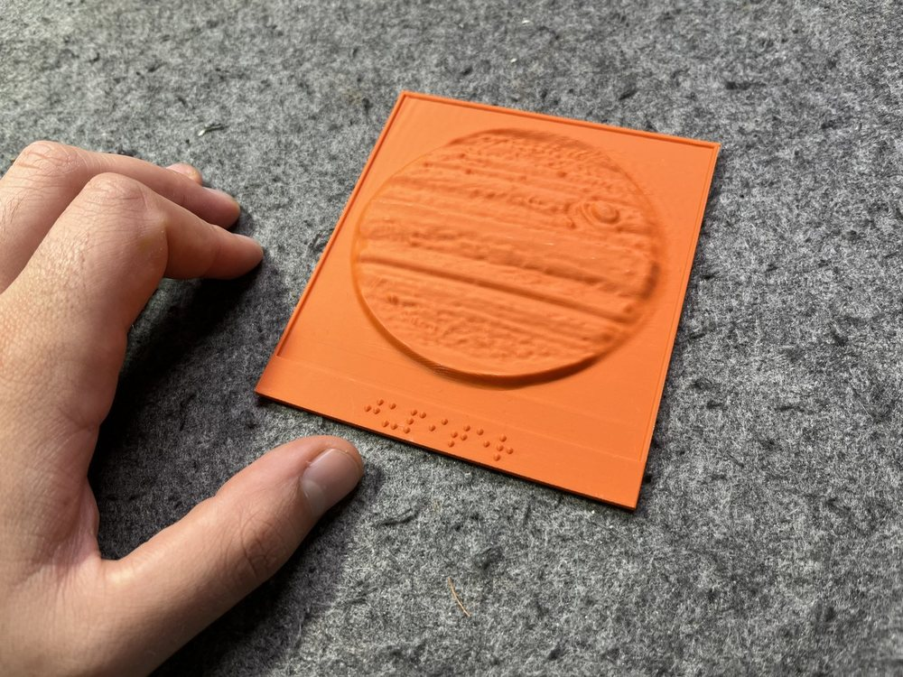
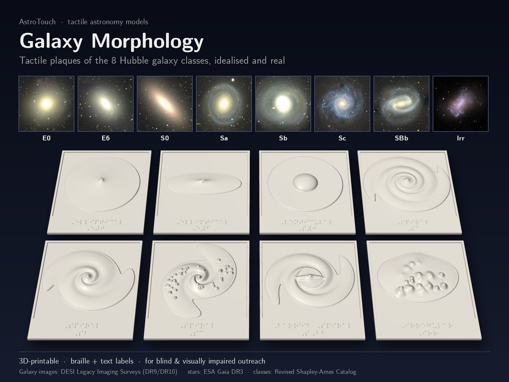
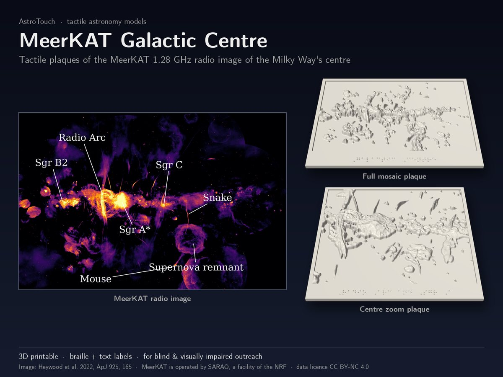
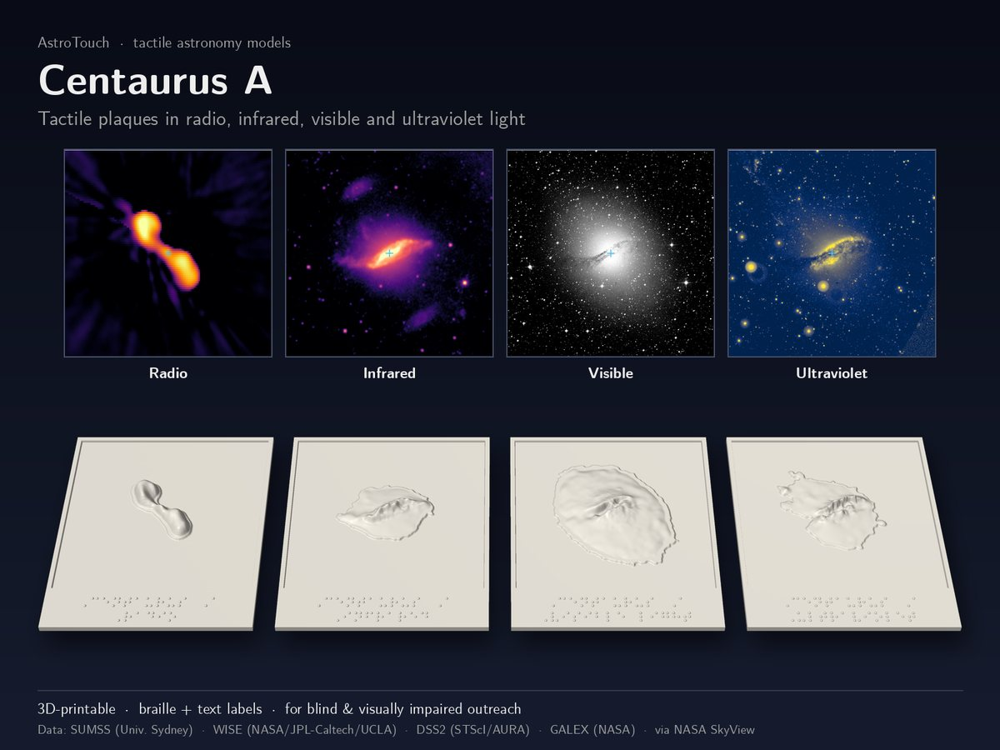
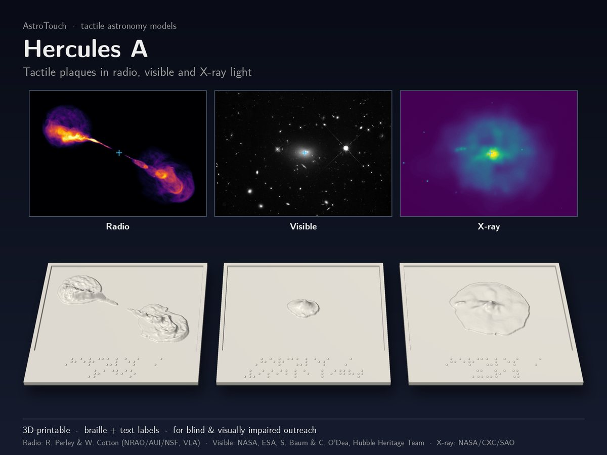
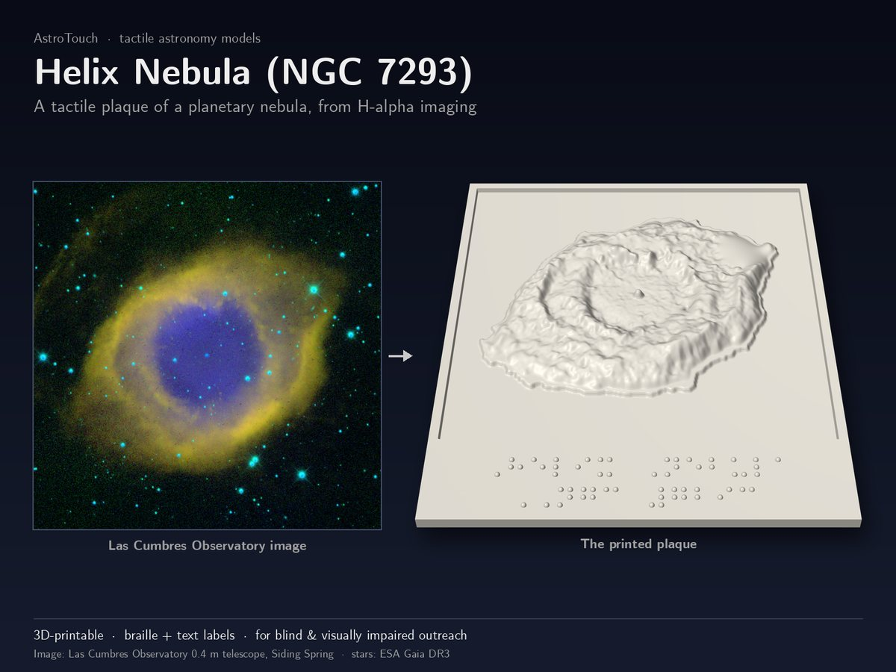
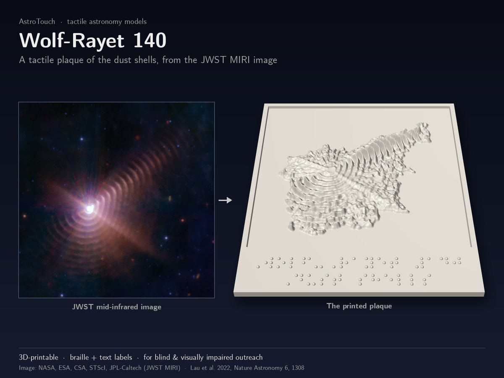
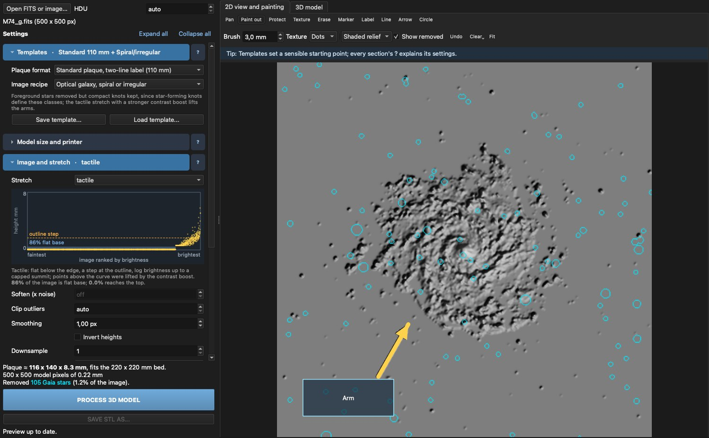

# AstroTouch

[](https://github.com/enzoperesafonso/AstroTouch/actions/workflows/tests.yml)
[](LICENSE)

[](CONTRIBUTING.md)

**Feel the universe.** AstroTouch turns astronomical images into 3D-printable tactile models. It reads FITS files (and pictures such as press-release images) and makes relief plaques where height follows brightness, with braille or raised-print labels, for astronomy outreach with blind and visually impaired (BVI) people.

<table>
  <tr>
    <td width="62%"></td>
    <td width="38%"></td>
  </tr>
  <tr>
    <td><sub>Printed AstroTouch plaques.</sub></td>
    <td><sub>Jupiter from a JWST image, with its braille label.</sub></td>
  </tr>
</table>

---

## What it makes

Each set below shows the real image beside the plaques made from it. All were built with AstroTouch, and are designed to be explored by touch.

<table>
  <tr>
    <td width="50%"></td>
    <td width="50%"></td>
  </tr>
  <tr>
    <td><b>Galaxy morphology:</b> the eight Hubble classes, from a smooth elliptical dome to knotty spiral arms.</td>
    <td><b>MeerKAT Galactic Centre:</b> the radio image of the Milky Way's heart, with the black hole as the summit.</td>
  </tr>
  <tr>
    <td></td>
    <td></td>
  </tr>
  <tr>
    <td><b>Centaurus A in four kinds of light:</b> the same patch of sky in radio, infrared, visible and ultraviolet.</td>
    <td><b>Hercules A:</b> radio jets far larger than the galaxy you can see, and the hot gas around it.</td>
  </tr>
  <tr>
    <td></td>
    <td></td>
  </tr>
  <tr>
    <td><b>Helix Nebula:</b> a ring of glowing gas around a dying star, with a marker for the star.</td>
    <td><b>Wolf-Rayet 140:</b> nested dust shells from JWST, one ridge per eight-year orbit.</td>
  </tr>
</table>

<sub>Image credits are listed under [Credits](#credits).</sub>

---

## Features

**Images in**
*   FITS files, with automatic detection of the 2D image in multi-extension files, or pictures (PNG, JPEG, TIFF).
*   Noise cleaning for radio maps: noise is masked and empty sky becomes a perfectly flat base, so only real emission is printed.
*   Removal of foreground stars (Gaia DR3) and compact sources, filled by harmonic inpainting so no bumps or dips are left behind.

**Heights designed for touch**
*   Linear, log, arcsinh and a **tactile** stretch: a definite step at the object's outline, a capped peak, and a local-contrast boost that lifts arms, knots and shells.
*   Block-mean downsampling (noise averages away instead of turning into grit), with optional ridge preservation for thin filaments, and an automatic cap on resolution so STLs stay small.
*   Removal of compact islands that could be mistaken for braille dots, and marker domes for things too faint to feel.
*   Hand-painted tactile textures (dots, lines, grid), so regions can be told apart by touch.
*   Raised lines, arrows and rings, and braille or text labels placed on the image itself, each on a flat pad so it can be read.

**Labels**
*   Unified English Braille grade 1 (uncontracted) with capital, capitals-word, number and grade 1 indicators and common punctuation, in standard dot sizes. Braille is never shrunk: a label that doesn't fit, or a character that can't be written, is an error rather than silently altered.
*   Raised print for sighted helpers and low-vision visitors, standing its full height on a shared baseline.
*   One or more lines, in a dedicated flat label strip.

**Tools**
*   A desktop GUI with a live preview, painting tools and a 3D view, with built-in help: a getting-started guide, an explanation for every group of settings, hints for each tool, and a live chart of what the stretch does to your image.
*   Templates: plaque formats (large 200 mm, standard 110 mm, small 90 mm) and image recipes (radio map, radio mosaic, smooth or knotty galaxy, nebula, press picture), in the GUI and on the command line. Save your own.
*   A command-line tool for batch builds, which can reuse anything painted in the GUI.
*   A Python API.

---

## Installation

You need Python 3.10 or later, and a 3D printer (or a slicer such as PrusaSlicer or Cura to look at the models).

```bash
git clone https://github.com/enzoperesafonso/AstroTouch.git
cd AstroTouch
pip install -e ".[gui]"          # or: pip install -r requirements.txt
```

This installs two commands, `astrotouch-gui` and `astrotouch`. Without installing, `python gui.py` and `astrotouch` do the same from the cloned folder. To run the tests: `pip install -e ".[gui,dev]"`, then `pytest`.

---

## Quick start

**Desktop GUI**
```bash
astrotouch-gui
```
Open a FITS file or picture (or drag one onto the window), choose a plaque format and an image recipe under **Templates**, and adjust from there. The 2D view shows a shaded preview of the model and updates as you change settings. Click **Process 3D model** to build the mesh, then **Save STL as...**. **Help > Getting started** walks through the steps, and every settings section has a **?** button.

**Command line**
```bash
astrotouch input.fits output.stl --plaque standard --recipe radio --label "Giant Radio" --label "Galaxy 3"
```

---

## Recipes

Which settings work depends on the kind of image. The built-in templates cover these (`--recipe radio`, `--plaque large`, ...; `astrotouch --list-templates` describes them all), and any option you add overrides the template:
```bash
astrotouch grg.fits grg.stl --plaque large --recipe radio --label "Giant Radio Galaxy 3"
```
Written out in full, these are good starting points.

**Radio maps** (e.g. MeerKAT, VLA): clean the noise, then use an asinh stretch, which compresses from about 1σ upward and gives faint lobes real height.
```bash
astrotouch grg.fits grg.stl --clean --asinh --longest-side 200 --max-height 12 \
  --border-width 5 --border-height 2 --label-area 24 \
  --label-mode braille --label "Giant Radio" --label "Galaxy 3"
```
For mosaics whose noise varies, add `--noise-box 110`. For thin filaments, add a broad detection scale and ridge preservation (e.g. `--smooth-scales 3 9 --downsample 12 --ridge 0.4`).

**Optical galaxies and nebulae** (e.g. Legacy Survey, LCO): remove the foreground stars, then use the tactile stretch.
```bash
astrotouch m74_g.fits m74.stl --mask-stars --gaia-cache m74_gaia.csv \
  --tactile --longest-side 110 --max-height 8 --label-area 24 \
  --label-mode braille --label "Spiral" --label "Sc M74"
```
Add `--remove-points` for smooth galaxies (ellipticals, lenticulars), but not for objects whose knots matter (Sc spirals, irregulars). Use `--protect X Y R`, or the GUI's Protect brush, to keep a nucleus or central star.

**Nebulae with a central star** (e.g. the Helix): remove the stars, use the tactile stretch, and mark the central star, which is too faint to feel.
```bash
astrotouch helix.fits helix.stl --recipe nebula --plaque standard --gaia-cache helix_gaia.csv \
  --marker-radec 337.41015 -20.83713 --label-mode braille --label "Helix Nebula" --label "NGC 7293"
```

**Press-release pictures** (PNG, JPEG): these were already stretched for display, so heights follow the displayed brightness. A linear or tactile stretch usually suits them best.
```bash
astrotouch wr140.png wr140.stl --remove-points --point-box 21 --point-sigma 4 \
  --tactile --contrast 4 --remove-compact 3 --longest-side 110 \
  --label-mode braille --label "Wolf-Rayet 140" --label "Dust shells" --label-area 24
```

**Data in small units** (e.g. Jy/beam) without cleaning: add `--soften 3` to `--log` or `--asinh`. Without it, both stretch almost linearly.

---

## Desktop GUI



*   **Help.** Help > Getting started, a **?** on every settings section that explains it in plain language, and a hint bar under the tools that says what the current tool does and what to do next.
*   **Templates.** Pick a plaque format and an image recipe; save and load your own (they keep settings, not painting or labels).
*   **Stretch chart.** Under *Image and stretch*, every part of the image ranked from faintest to brightest against the height it gets: how much is flat base, where the tactile outline step is, and what the contrast boost lifts.
*   **Settings.** Every command-line option, grouped in collapsible sections: size and print bed, image and stretch, tactile stretch, noise cleaning, stars and compact sources (Gaia), paint-out/texture/markers, and border and label.
*   **Live 2D preview.** A shaded relief of the final height map (or the input image), rebuilt in the background a moment after any change. Below it are the plaque's overall size and whether it fits your print bed.
*   **Painting tools** on the 2D view. Scroll to zoom, middle-drag or use the Pan tool to move, and press Ctrl/Cmd+Z to undo.
    *   **Paint out:** remove anything by hand, either filled from its surroundings (inpainted before cleaning, as if it was never there) or flattened to the base.
    *   **Protect:** areas that star and compact-source removal must never touch, such as a galaxy nucleus or a nebula's central star.
    *   **Texture:** paint a raised pattern (dots, lines or grid) onto any area. Spacing and height are set in the sidebar.
    *   **Erase**, and **Marker**: click to place a dome, right-click to remove it.
    *   **Label:** click to place a braille or text label on the image; double-click it to edit. Each label sits on a flat pad, since braille can't be read over bumpy relief.
    *   **Line** and **Arrow:** click the points of a raised line (double-click or Enter to finish, Esc to cancel), for leader lines and pointers.
    *   **Circle:** drag from the centre for a raised ring (or a filled disc).
    *   Right-click any shape or label to delete it.
    *   Warnings appear under the settings, e.g. when a label's pad would cut into a source, or lines are too narrow for the model's pixels.
*   **3D view** of the finished model.
*   **Saving** writes the STL, plus the painted layers (`name.paintout.fits`, `name.protect.fits`, `name.texture.fits`) and every setting (`name.astrotouch.json`) beside it, so the model can be rebuilt, also from the command line.

---

## Command-line reference

Run `astrotouch --help` for the full list with current defaults. Pixel positions are 0-based (x, y) in the input image; for pictures, they are as shown in an image viewer.

### Templates

| Argument | Description |
| :--- | :--- |
| `--plaque NAME` | Plaque format: `large` (200 mm), `standard` (110 mm, two-line label) or `small` (90 mm). |
| `--recipe NAME` | Image recipe: `plain`, `radio`, `radio_filaments`, `galaxy_smooth`, `galaxy_knotty`, `nebula`, `press_picture`. |
| `--template JSON` | A template saved from the GUI (or a GUI-saved `.astrotouch.json`). |
| `--list-templates` | Describe the templates and exit. |

Options you give explicitly always override the template.

### Input, size and output

| Argument | Default | Description |
| :--- | :--- | :--- |
| `input` | (required) | FITS file, or a picture (PNG, JPEG, TIFF). |
| `output` | input.stl | Output STL file. |
| `--hdu` | auto | HDU index containing the 2D image. |
| `--longest-side` | 150 mm | Length of the image's longest side on the model (0 for 1 mm per pixel). |
| `--max-height` | 10 mm | Height of the brightest features above the base. |
| `--base-thickness` | 2 mm | Thickness of the solid base plate. |
| `--bed W D` | | Warn if the model doesn't fit a print bed of this size (mm). |
| `--verbose` | | Detailed logging. |

### Image and stretch

| Argument | Default | Description |
| :--- | :--- | :--- |
| `--clip` | 1% (0 with `--clean` or `--tactile`) | Percentile to clip at each end. |
| `--smooth` | 1.0 | Gaussian smoothing sigma, in model pixels (0 to disable). |
| `--downsample` | 1 | Downsampling factor. |
| `--downsample-method` | mean | `mean` (block mean: noise averages away) or `linear` (interpolation, which turns noise into grit). |
| `--ridge` | 0 | Mix this fraction of the block maximum into the block mean, so thin features stay continuous ridges. Cleaned maps only. |
| `--min-pixel` | 0.3 mm | Downsample automatically so model pixels are at least this size. Finer than a 0.4 mm nozzle only bloats the STL. 0 disables. |
| `--nan-value` | minimum | Value for blank (NaN) pixels. |
| `--log`, `--asinh`, `--tactile` | linear | Stretch (choose one). |
| `--soften N` | off | Divide by N × the noise rms before `--log`/`--asinh`, so the stretch compresses whatever the data's units. |
| `--invert` | | Brightest pixels become lowest. |

**Tactile stretch** (`--tactile`): log brightness from an outer edge to a capped peak.

| Argument | Default | Description |
| :--- | :--- | :--- |
| `--edge` | sky + 3 × noise (with `--clean`: `--detect-sigma`) | Outer isophote, in data units. Fainter is flat base. |
| `--edge-step` | 0.2 | Height of the outline step, as a fraction of full height, so the edge is found at once. |
| `--contrast` | 1.5 | Local-contrast boost that lifts arms, bars, knots and shells (0 for a plain log stretch). |
| `--peak-percentile` | 99.9 | Brightness cap, so a bright core becomes a small summit instead of taking the whole height range. |

### Noise cleaning (radio maps and other noisy images)

Printed straight from the FITS file, a noisy image makes a poor model. The noise feels like sandpaper, noise peaks become bumps that can't be told from real sources, and faint diffuse emission is lost in that texture.

`--clean` fixes this in four steps:
1. It finds emission at native resolution and smoothed by about a beam.
2. It keeps only islands that are above 3σ and peak above 5σ.
3. It gives faint emission a smooth surface.
4. It sets everything else to exactly zero.

The result is in units of the noise, so combine it with `--asinh` or `--tactile`.

| Argument | Default | Description |
| :--- | :--- | :--- |
| `--clean` | off | Enable noise cleaning. |
| `--beam BMAJ BMIN` | from header | Beam FWHM in pixels (`BMAJ`/`BMIN` header keywords). |
| `--detect-sigma` | 3 | Island boundary, in units of the noise. |
| `--peak-sigma` | 5 | An island must peak above this at some scale to be kept. |
| `--min-island` | ½ beam (12 px) | Smallest island kept, in pixels. |
| `--smooth-scales` | 1 beam σ | Gaussian sigmas (px) of the detection scales. Add a broad one to lift very faint, extended emission, at the cost of softer edges. |
| `--noise-box` | global | Measure a local noise map in boxes of this many pixels, for mosaics. |
| `--save-cleaned` | | Also write the cleaned map to a FITS file, for review. |

### Stars and compact sources (optical and infrared images)

Masked pixels are filled by harmonic inpainting, which cannot create bumps or dips of its own.

| Argument | Default | Description |
| :--- | :--- | :--- |
| `--mask-stars` | off | Remove foreground stars from Gaia DR3 (needs a celestial WCS and the network). Only stars that move, or are brighter than G = 15.5, are removed, so clusters and knots inside a galaxy stay. |
| `--gaia-cache` | | Cache the Gaia list in this file. |
| `--remove-points` | off | Remove compact sources that stand out from a median filter (faint stars, globular clusters, small background galaxies). |
| `--point-box`, `--point-sigma`, `--max-point-area` | 9 px, 5, 60 px | Median filter width (a few star widths; ~21 for JWST pictures), threshold, and largest source removed. |
| `--mask X Y R` | | Also remove this disc; repeatable. |
| `--protect X Y R` | | Never remove anything inside this disc; repeatable. |

### Compact islands, markers and textures

| Argument | Default | Description |
| :--- | :--- | :--- |
| `--remove-compact MM` | off | Remove isolated islands smaller than this across on the model; they print as pips that can be mistaken for braille. Needs a flat background (`--clean` or `--tactile`). |
| `--compact-fraction`, `--compact-cap` | 0, 0.15 | Keep them as low pips instead: lowered to this fraction of their height, capped at this fraction of full height. |
| `--marker X Y`, `--marker-radec RA DEC` | | A smooth dome at this position (pixels, or degrees with a WCS); repeatable. |
| `--marker-size`, `--marker-height` | 3 mm, 0.3 | Dome diameter, and height above the surrounding relief (fraction of full height). |
| `--texture-spacing`, `--texture-height` | 4 mm, 0.6 mm | Pattern spacing and height for `--texture-map`. |

### Painted layers (from the GUI, or any mask)

Masks can be FITS or PNG of any size; they are stretched to cover the whole image.

| Argument | Default | Description |
| :--- | :--- | :--- |
| `--paint-out MASK` | | Remove the non-zero areas. |
| `--paint-out-mode` | fill | `fill`: inpaint from the surroundings, before cleaning. `flatten`: set to flat base. |
| `--protect-mask MASK` | | Never remove stars or compact sources inside these areas. |
| `--texture-map MAP` | | Raise a texture where the map is 1 (dots), 2 (lines) or 3 (grid). |

### Shapes and labels on the image

| Argument | Default | Description |
| :--- | :--- | :--- |
| `--annotations JSON` | | Shapes and labels drawn in the GUI (its saved `name.astrotouch.json`), or a JSON list written by hand (below). |
| `--shape-width`, `--shape-height` | 1.2 mm, 0.8 mm | Raised lines and rings follow the relief. Tactile guidance: at least about 1 mm wide and 0.5–1 mm high. |
| `--image-label-mode` | braille | `braille` or `text`. |
| `--image-label-pad` | base | Each label sits on a flat pad: `base` (cut down to the base) or `raised` (a platform at the highest point beneath it). The pad slopes back to the relief around it. |
| `--image-label-margin` | 2 mm | Flat margin around each label. |

The JSON is a list of objects with 0-based pixel positions, row 0 at the bottom of the image (FITS orientation):
```json
[
  {"type": "label", "x": 300, "y": 40, "text": "Y lobe"},
  {"type": "line", "points": [[250, 45], [150, 60]], "arrow": true},
  {"type": "line", "points": [[10, 10], [60, 10], [60, 60]], "closed": true},
  {"type": "circle", "x": 310, "y": 220, "radius_mm": 6, "filled": false}
]
```
Any object can override the defaults with `"width_mm"` and `"height_mm"` (shapes) or `"mode"` and `"pad"` (labels). Braille is never shrunk, so a label too big for its place is an error; keep labels to a few cells.

### Border and label

| Argument | Default | Description |
| :--- | :--- | :--- |
| `--border-width`, `--border-height` | 0 mm | A raised frame around the image. |
| `--label TEXT` | | A label line; repeat for more lines (`--label "Centaurus A" --label "Radio"`). |
| `--label-mode` | text | `text` (raised print) or `braille`. |
| `--label-depth` | 1.5 mm text / 0.8 mm braille | Height of the raised text, or of the braille dots (standard dots are 0.5–0.9 mm). |
| `--label-size` | 5 mm | Cap height of text. All lines share it; if a line is too wide, all lines shrink together. Braille is never scaled. |
| `--label-area` | 0 mm | Depth of a flat strip at the bottom for the label. Allow about 10 mm per braille line. |
| `--label-spacing` | 10 mm braille / 1.7 × size text | Distance between line centres. |

---

## How it works

A model is built in this order, the same in the GUI, the command line and the Python API:

1. **Load** the FITS image or picture. Pictures are flipped so that, as in FITS, the bottom row is south; the model matches the picture.
2. **Remove** stars, compact sources and painted-out areas, and inpaint them.
3. **Clean** the noise (optional), giving a map in units of the noise with a zero background.
4. **Downsample and stretch** to heights between 0 and 1.
5. **Compact islands**, **flattened paint-out**, **smoothing**, **markers**, **textures**, **raised shapes** and **label pads**, in that order, so nothing added by hand is blurred, and leader lines stop at their labels.
6. **Mesh:** a watertight relief on a solid base, with the border, the label strip, and the labels on the image.

---

## Designing for touch

*   **Heights:** raised features need to be at least about 0.5–1 mm high and about 3 mm apart, and edges or steps are found far more easily than gentle slopes. The tactile stretch's outline step and contrast boost are built around this.
*   **Braille:** labels are machine-encoded UEB grade 1. Have a braille reader check every label before printing a set.
*   **Things that are not data:** markers, textures, shapes and exaggerated relief should be pointed out when presenting a model.
*   **Labels on the image:** put them in clear sky. A pad over a source flattens part of it (AstroTouch warns when it does); a leader line or arrow can point from the label to the feature.
*   **Textures:** keep texture dots clearly different from braille (2.5 mm dot spacing, 1.5 mm dots); the default 4 mm spacing does this.
*   **Compact sources:** small round pips can be mistaken for braille dots. Remove or lower them (`--remove-compact`) unless they are part of the story.

## Printing

*   Print flat on the base, with no supports. 10–15% infill is enough.
*   Use a 0.2 mm layer height for large plaques, and 0.12–0.16 mm for small ones, so braille dots and thin ridges stay crisp.
*   Check the size against your bed (`--bed`, or the GUI's print bed setting). The label strip and border add to the image size.

---

## Python API

```python
from astrotouch import pipeline

builder = pipeline.ModelBuilder.from_file("grg.fits")
settings = pipeline.Settings(clean=True, stretch="asinh", longest_side_mm=200, max_height_mm=12,
                             label=("Giant Radio", "Galaxy 3"), label_mode="braille", label_area_mm=24)
result = builder.height_map(settings)          # heights in [0, 1], plus pixel size
builder.mesh(settings, result).save("grg.stl")
```

`ModelBuilder` caches the slow stages (star removal, cleaning), so changing only the stretch or size is quick. The building blocks are also available on their own: `clean.clean_image`, `sources.remove_sources`, `shaping.tactile_stretch`, `shaping.apply_texture`, `core.generate_label_mesh` and `core.ueb_cells`.

---

## Project structure

*   `src/astrotouch/`
    *   `pipeline.py`: the model-building pipeline, settings and templates, shared by the GUI, the command line and Python.
    *   `core.py`: loading, preprocessing and stretches, mesh generation, braille and text labels, and the command line.
    *   `clean.py`: noise cleaning.
    *   `sources.py`: star and compact-source removal, and inpainting.
    *   `shaping.py`: downsampling, the tactile stretch, compact islands, markers, textures, raised shapes and shaded relief.
    *   `gui.py`, `help_text.py`: the desktop GUI and its help.
*   `gui.py`, `cli.py`: run the GUI and the command line from a clone without installing.
*   `tests/`: automated tests (run with `pytest`).
*   `assets/`: documentation images.

---

## Contributing

Contributions of every kind are welcome, and many need no code at all:

*   **Try the models with blind or low-vision people** and tell us what could be felt: this is the most valuable help there is ([feedback form](../../issues/new?template=accessibility_feedback.yml)).
*   **Check the braille**, if you read it.
*   **Share a model or suggest an object** with its data ([form](../../issues/new?template=model_or_data.yml)).
*   **Report bugs, suggest features, improve the code or the docs.**

[CONTRIBUTING.md](CONTRIBUTING.md) explains the setup, how the code fits together, and how to add a setting or a template. Please follow the [Code of Conduct](CODE_OF_CONDUCT.md). Changes are listed in the [changelog](CHANGELOG.md).

---

## Citing

If you use AstroTouch in your work, please cite it: GitHub's **Cite this repository** button gives the reference from [CITATION.cff](CITATION.cff).

---

## Credits

Images of the model sets above:
*   **Galaxy morphology:** DESI Legacy Imaging Surveys (DR9, DR10); stars from ESA Gaia DR3; classes from the Revised Shapley-Ames Catalog.
*   **MeerKAT Galactic Centre:** Heywood et al. (2022), ApJ 925, 165. The MeerKAT telescope is operated by the South African Radio Astronomy Observatory, a facility of the National Research Foundation, an agency of the Department of Science and Innovation. Licence CC BY-NC 4.0.
*   **Centaurus A:** SUMSS (University of Sydney), WISE (NASA/JPL-Caltech/UCLA), DSS2 (STScI/AURA), GALEX (NASA), via NASA SkyView.
*   **Hercules A:** radio R. Perley and W. Cotton (NRAO/AUI/NSF, VLA); visible NASA, ESA, S. Baum and C. O'Dea (RIT) and the Hubble Heritage Team (STScI/AURA); X-ray NASA/CXC/SAO.
*   **Helix Nebula:** Las Cumbres Observatory (0.4 m telescope, Siding Spring); stars from ESA Gaia DR3.
*   **Wolf-Rayet 140:** NASA, ESA, CSA, STScI, JPL-Caltech (JWST MIRI); Lau et al. (2022), Nature Astronomy 6, 1308.
*   **GUI screenshot:** M74 from the DESI Legacy Imaging Surveys.

---

## Motivation

Astronomical data is overwhelmingly visual. This project aims to bridge the gap with a tool that turns celestial objects and data into tactile models, making astronomy more accessible and engaging for people who are blind or visually impaired. By feeling the contours, peaks and valleys of stars, nebulae and galaxies, people can gain a different understanding of astronomical structures.

---

## License
This project is licensed under the MIT License - see the [LICENSE](LICENSE) file for details.

By **Enzo Peres Afonso** (2025).
